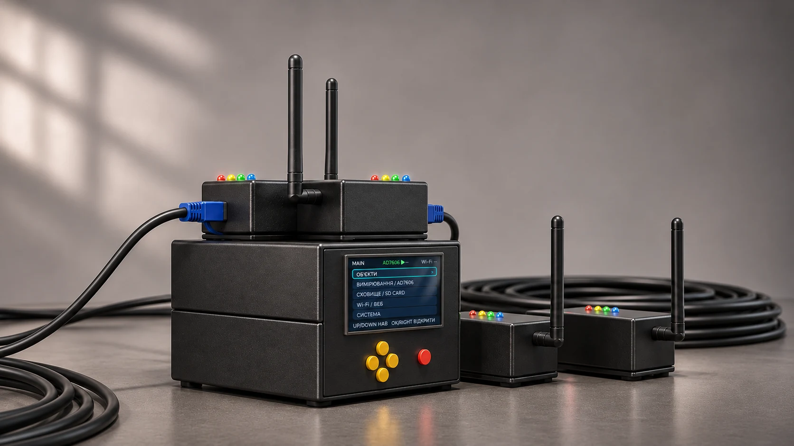

# ESP32 Geophone Source Locator



ESP32-S3 diploma prototype for seismic search under rubble. The firmware acquires multiple geophone channels simultaneously, stores object/measurement data on microSD, exposes a local web interface, provides a local TFT UI, and now contains a reusable 3D TDOA geometry solver for the later localization pipeline.

The project targets **ESP-IDF v5.5.4** on an ESP32-S3 N16R8 board.

For the component/runtime design, task ownership and extension rules, see [ARCHITECTURE.md](ARCHITECTURE.md).

Structural code search and linting use [ast-grep](docs/ast-grep.md).

## Current hardware architecture

### ESP32-S3

The controller is an ESP32-S3 with 16 MB flash and 8 MB octal PSRAM.

PSRAM runs at 80 MHz. If the board is unstable (random crashes after a ~20 °C temperature change or boot failures), revert to `CONFIG_SPIRAM_SPEED_40M`; HIL validation is required.

GPIO33-GPIO37 are occupied by octal PSRAM internally and are intentionally not assigned to application peripherals.

### SPI2: UI and storage

SPI2 is shared only by the TFT and microSD card:

| Signal | ESP32-S3 GPIO |
| --- | ---: |
| MOSI | 11 |
| SCLK | 12 |
| MISO | 13 |
| TFT CS | 14 |
| TFT DC | 15 |
| TFT RESET | 16 |
| microSD CS | 17 |

The current firmware sets the microSD SPI runtime ceiling to **20 MHz** (`SDMMC_FREQ_DEFAULT`); discovery starts at 400 kHz. This is the configured ceiling, not a claim that the present wiring has been physically validated at that rate.

### SPI3: dedicated AD7606 acquisition bus

AD7606 is isolated from the display/storage bus and owns SPI3:

| AD7606 signal | ESP32-S3 GPIO |
| --- | ---: |
| DOUTA / DB7 / MISO | 39 |
| RD / SCLK | 40 |
| CS | 41 |
| CONVST A + CONVST B | 42 |
| BUSY | 47 |
| RST | 2 |

AD7606 serial mode is read-only, therefore SPI3 MOSI is unused. A 10 kOhm pull-up is used on AD7606 CS.

Current AD7606 board configuration:

- RANGE low: +/-5 V input range;
- OS0/OS1/OS2 low: no hardware oversampling;
- 8 simultaneous channels;
- SPI mode 2;
- 1 MHz SPI clock;
- default acquisition rate: 500 Hz.

The first four AD7606 channels currently feed the application seismic ring buffer. All eight channels are read on every conversion and are available to the local TFT diagnostics UI.

### Other current GPIO assignments

| Function | GPIO |
| --- | ---: |
| Analog keypad KS0466 | 8 |
| Pololu power-off control | 18 |
| External power-button sense | 21 |

GPIO1 is reserved by the existing divider/bench wiring and must not be reused for AD7606.

### nRF54L15 subproject

`nRF54L15/` is an independent PlatformIO + Zephyr project for all XIAO
nRF54L15 nodes. It has one production source tree, one production environment
and one firmware binary; runtime topology and Bluetooth initiator/reflector
roles do not create central/remote builds. The main node is on the ESP32-S3
upstream I2C bus; remote nodes are behind TCA9548A channels. Each remote nRF
locally aggregates its GY-BMI160 and BME280 on the second XIAO I2C pair
(`D11/P0.03` SCL, `D12/P0.04` SDA), powered from XIAO `3V3_OUT`. These local
sensors are not direct ESP32/TCA devices. RJ45 pin 2 (+3.3 V) is reserved/NC
and must not be tied to `3V3_OUT`.

The installed boards are the **plain XIAO nRF54L15, not the Sense variant**,
so they have no built-in IMU. Each remote geophone uses an external
**GY-BMI160** and BME280 on the XIAO's private second I2C bus: `D11/P0.03` is
SCL and `D12/P0.04` is SDA. The upstream ESP32/TCA bus remains on
`D4/P1.10` SDA and `D5/P1.11` SCL. The main-enclosure nRF54L15 does not
require the remote-only sensor assembly.

The REMOTE logger LEDs show GREEN while READY when no fault has latched; GREEN
means “no latched fault,” not that sensor preparation has completed. An
unattempted sensor is pending, while a failed BMI160 or required BME280 init is
an immediate ERROR. Runtime IMU/ENV fault bits count only after that sensor is
READY. WARNING must persist for 2000 ms before YELLOW latches; ERROR/FATAL is
immediate, and latches clear only on reset. `LOG_RING_LOSS` latches WARNING
when `overwritten_total > 0` (internal logger losses also map to WARNING). The
128-record ring can overwrite during a bench run without an ESP32 collector,
producing a latched YELLOW; this is expected bench behavior.

The authoritative topology, local sensor/power contract, external
GY-BMI160/verticality contract, Channel Sounding role rotation and remote LED
pinout are in
[`ARCHITECTURE.md`](ARCHITECTURE.md). The future nRF implementation and
testing task is [`docs/nrf54l15-test-task.md`](docs/nrf54l15-test-task.md).

## UI architecture

The TFT UI uses **LVGL 9** through Espressif's official **esp_lvgl_port** integration. The display component is limited to the physical `esp_lcd` / ILI9341 layer; widgets, text, QR rendering, navigation, refresh timing and buffering belong to LVGL.

Managed dependencies are pinned through the ESP-IDF Component Manager:

- `espressif/esp_lcd_ili9341 ^2.0.2`;
- `espressif/esp_lvgl_port ^2.9.0`;
- `lvgl/lvgl ^9.5.0`;
- `espressif/button 4.2.0` for the keypad and power-button adapters;
- `espressif/i2c_bus 1.5.2` for the shared INA3221 sensor bus;
- `espressif/led_indicator 2.1.2` as the disabled, board-wiring-gated status backend;
- `espressif/esp-dsp 1.8.2` for the task-free measured-signal foundation;
- optional `espressif/esp_insights 1.3.4`, disabled in the baseline image.

The previous project-local 5x7 bitmap font and custom text-rendering stack are no longer part of the active display architecture.

The LVGL handler task is pinned to **Core 0**. The five-button analog keypad
uses official ADC Button objects over the existing ADC1 owner, and the GPIO21
power input uses the official GPIO Button object with external pull circuitry.
Both adapters publish to the dedicated ESP-IDF `APP_EVENT` user loop; the UI
subscriber only queues events and applies them from the existing LVGL timer.
The event loop contract is documented in
[`ARCHITECTURE.md`](ARCHITECTURE.md), and the before/after resource snapshot is
in [`docs/architecture-refactor-baseline-2026-09-12.md`](docs/architecture-refactor-baseline-2026-09-12.md).

Screen behavior is registered through one `ui_screen_driver_t` table. Open/render/key/refresh behavior and the Home menu label therefore have one source of truth instead of duplicated enum/switch routing.

Current screens:

- Home;
- Objects;
- Measurements;
- Storage;
- Wi-Fi / Web;
- System.

The **Measurements** screen is live, not a placeholder. For the AD7606 build it displays:

- acquisition source and RUN/STOP state;
- sample rate and channel count;
- real-time core assignment;
- SPI3 transport, SPI mode and bus clock;
- configured +/-5 V range and hardware oversampling ratio;
- successful sample count, read errors and consecutive failures;
- age of the last simultaneous sample;
- live V1..V8 values in mV.

The UI consumes a read-only `seismic_acquisition_snapshot_t`; it does not access AD7606 GPIO or SPI functions directly.

## CPU/task policy

Application-owned tasks are split by role.

### Core 0 - services

- LVGL handler and bounded UI event application;
- ESP-IDF `APP_EVENT` user loop and official Button service;
- object service;
- storage service;
- Wi-Fi/HTTP-facing application work.

### Core 1 - real-time side

- AD7606 acquisition;
- synthetic seismic test source;
- future signal preprocessing / event detection;
- future continuous localization worker if required.

All application task priorities, stacks and core assignments are centralized in `components/app_config/include/app_task_config.h`.

The AD7606 task initializes and owns SPI3 on Core 1 so the dedicated acquisition bus and its interrupt affinity remain on the real-time side.

## Seismic acquisition pipeline

For the AD7606 source:

```text
geophone
   -> low-noise analog amplifier/filter
   -> AD7606 simultaneous analog inputs
   -> CONVST
   -> timestamp captured at the sampling event
   -> BUSY completion
   -> SPI3 read of V1..V8
   -> acquisition diagnostics snapshot
   -> seismic ring buffer
   -> web / recording / future signal processing
```

The frame timestamp is captured immediately after the CONVST rising edge, not after BUSY handling and SPI transfer.

The seismic ring buffer uses short metadata critical sections plus per-slot publication sequencing. HTTP snapshots do not hold a long mutex while copying hundreds of waveform frames, so a slow web reader does not block the acquisition producer for the duration of the copy.

## Acquisition source interface

The source is selected at build time in `menuconfig`:

- `AD7606 SPI acquisition` - normal hardware path;
- `Synthetic test waveform` - software-only waveform source.

Each backend implements the same private `seismic_source_driver_t` interface. The acquisition orchestrator itself is backend-agnostic; compile-time selection is isolated in the source registry. Runtime source switching is intentionally not exposed yet.

Current backend files:

- `seismic_source_ad7606.c`;
- `seismic_source_test.c`.

Adding a new source should add a descriptor and registry entry rather than adding source-specific branches to `seismic_acquisition.c`.

## TDOA localization component

The repository now contains an independent `localization` component with a reusable 3D TDOA solver:

```c
esp_err_t localization_tdoa_solve(...);
```

It accepts:

- 4..8 sensor positions in meters;
- one arrival timestamp per sensor for the same detected event;
- a propagation speed in m/s;
- an optional initial source-position guess.

It returns:

- estimated `(x, y, z)` source position;
- estimated emission time;
- RMS timing residual;
- iteration count;
- convergence status.

The solver rejects degenerate/coplanar 3D sensor geometry and uses damped nonlinear least-squares iterations.

Beside it, `localization_velocity_free` provides three methods that estimate the event's own velocity: **TDCAS** (P picks, 6 sensors or 5 on a flat array), **PSAFUVS** (P and S picks, 4 flat sensors suffice) and **SUEA** (shortest travel paths around empty areas). "Calculate source" runs all of them; when the session has a registered 3D scan, their scan-constrained variants use the scan's empty (FREE) and filled (OCCUPIED) space. See [ARCHITECTURE.md](ARCHITECTURE.md#velocity-free-methods-and-the-3d-scans-emptyfilled-space).

`localization_extended` adds five more: **cross-correlation TDOA** over every pod pair, a **robust** outlier-rejecting fit, **PSP** (P-TDOA and S-P jointly), **eikonal** travel times that go around the scan's voids (plus tomography from calibration hits), and a **Bayesian** posterior that reports a 90% credible region instead of a bare point. With four flat pods, place them off a common circle (not in a rectangle) if you want the velocity-free methods. See [ARCHITECTURE.md](ARCHITECTURE.md#extended-methods-waveform-delays-robust-fits-p-s-eikonal-posterior).

**Important:** this does not mean the end-to-end locator is finished. The firmware still needs a validated preprocessing/event-detection stage that converts raw geophone data into reliable per-channel arrival timestamps. The propagation speed also cannot be hard-coded as a universal constant for heterogeneous rubble; `localization_default_config()` deliberately leaves `propagation_speed_mps` unset so the caller must provide a measured or modelled value.

Planned end-to-end path:

```text
AD7606 frames
   -> filtering / preprocessing
   -> event detection
   -> per-channel arrival-time picking
   -> sensor position / height data
   -> propagation model
   -> localization_tdoa_solve()
   -> source position + residual / quality
```

## Current timing limitation

Timestamp placement is already correct: timestamps represent CONVST, not later SPI completion.

The periodic trigger is still initiated by `esp_timer` + task notification. That is acceptable for the current bench stage, but it is not claimed to be the final deterministic sampling architecture. If the later TDOA error budget shows scheduler/trigger jitter to be significant, CONVST timing must move to a hardware-timed path rather than merely changing where software reads a timestamp.

## Storage and safe shutdown

Object and measurement state is stored under `/sdcard/geolocator`.

The shutdown sequence stops producers/services before cutting power:

```text
official Button adapters / shutdown latch
-> INA3221 monitor
-> shared sensor_bus / I2C0 release
-> measurement service / recorder finalization (LVGL guard still alive)
-> APP_EVENT UI subscriber / LVGL port
-> storage service
-> object service
-> seismic acquisition
-> HTTP / Wi-Fi
-> storage manager
-> SD unmount
-> display disable/deinit
-> power-off pulse
```

The SD handle is cleared only after successful FAT unmount. If unmount fails, software state still reflects that the card handle is present.

The TFT Storage screen requires a second confirmation before application-data erase is started.

## Web interface

The firmware starts a local HTTPS server on port 443 (`https://geolocator.local/`) and exposes device/seismic APIs including:

- `/api/status`
- `/api/seismic`

`/api/seismic` can return recent waveform frames without holding the acquisition producer behind a long reader-side copy.

The web component exposes only `include/web_server.h` publicly. Internal routes, JSON helpers, setup parsing and static-asset declarations share one private `web_server_internal.h` instead of a separate private header for every `.c` file.

## Build

For local firmware tests, the risk-based coverage plan and host/target verification boundaries, see [docs/firmware-test-plan.md](docs/firmware-test-plan.md). The project-wide validation contract, including the staged nRF54L15 software/HIL gates, is [docs/local-verification.md](docs/local-verification.md).

The sensor input/output map and its offline executable checks are in [docs/sensor-signals.md](docs/sensor-signals.md): `python tools/run_sensor_signal_checks.py`.

Install ESP-IDF v5.5.4 and open an ESP-IDF terminal in the repository directory.

When managed dependencies change:

```powershell
idf.py reconfigure
```

Build:

```powershell
idf.py build
```

Select another seismic backend:

```powershell
idf.py menuconfig
```

Then open **Seismic Acquisition** and select the required source.

## Flash and monitor

For repeatable local verification, use the tasks in `.vscode/tasks.json`:

* `Tests: nRF54L15` launches the isolated path-safe PlatformIO/Zephyr automatic
  software-test action through `nRF54L15/pio.ps1` without uploading a test
  image. Only explicitly qualified `test_sw_*` suites belong to this path.
* `nRF54L15: Flash firmware` builds and uploads the nRF54L15 image through
  `nRF54L15/pio.ps1`; it is a physical-board action and is not part of
  `Tests: All (no flash)`.
* `Tests: All (no flash)` is the no-flash project-wide entry point. It includes
  the nRF54L15 wrapper build and only qualified nRF software/native tests; an
  empty current `test_sw_*` surface is reported as `SKIPPED`. Physical nRF
  target/HIL suites are excluded even though PlatformIO also supports embedded
  tests.
* `ESP: Unity tests (flash COM4 + logs COM6)` runs the target Unity cases with
  a live COM4 preflight, an explicit test-app flash, and a bounded COM6 log
  capture.
* `ESP: Production pipeline HIL (COM4 + COM6)` builds the production image,
  prompts for the HTTPS base URL and an existing object ID, then runs the live
  acquisition/recorder/API gate with explicit COM4 flash and COM6 logging.
* `ESP: Flash production (COM4)` and `ESP: Monitor logs (COM6)` remain separate
  tasks for production firmware, each with its matching live-port preflight.
* `ESP-IDF: Monitor + Save Logs` lets you choose a COM port and keeps one UTF-8
  capture file in `logs/esp32/` while waiting through startup port errors and
  USB reconnects. `RUNNING` appears after UART data arrives. Stop the active
  monitor with `Ctrl+]`, or use `Ctrl+C` while it is retrying the connection.

For the keypad ADC/timer-task watchlist, use the dedicated opt-in procedure in
[docs/keypad-adc-timing-hil.md](docs/keypad-adc-timing-hil.md). It measures
broker snapshot `min/avg/p95/max` and shared `ESP_TIMER_TASK` dispatch lateness
for separate AD7606 500 Hz windows; it does not change the
production defaults. Its `KEYPAD_TIMING_TELEMETRY_RESULT` confirms only
telemetry validity and is independent of the physical keypad condition;
`PHYSICAL_CONDITION` and `KEYPAD_TIMING_RUN_RESULT` report the separate HIL
gate. Performance acceptance remains `NOT_ESTABLISHED` until real-board
baselines define thresholds.

The host contracts cover the AD7606 DMA configuration; the production HIL
runner reports AD7606 startup, configured-rate frame cadence, recorder/session
metadata, exact seismic channel IDs and bounded timestamp jitter,
`/api/seismic`/`/api/status` checks (including zero AD7606 read errors and
consecutive failures) and advancing FreeRTOS heartbeats for the
acquisition, recorder and UI loops. The official Button component owns input
sampling/debounce; its physical delivery and electrical behavior are checked
separately during HIL. During recording it
also requires acquisition and recorder progress to advance. It uses the device
monotonic `runtime.now_ms` to reject task heartbeats older than the configured
`-MaxTaskHeartbeatAgeMs` (default 1000 ms). TFT pixels and
keypad/power-button responsiveness still require a human observation during the
live Measurements run; use `-RequireFullPipeline` so missing API, SD or physical
evidence is reported as `BLOCKED` instead of being mistaken for a complete pass.
After observing the live screen, keypad navigation and ordered shutdown, repeat
the explicit command with `-ConfirmTftRendering -ConfirmKeypadResponsive
-ConfirmPowerButtonResponsive` to record those three manual attestations as
`PASS`.

Use the board programming port for flashing:

```powershell
idf.py -p COM4 flash
```

In the current bench setup an external USB-to-TTL adapter can be used as a passive UART monitor while the device runs from the 2x18650 power system. The external adapter must not power the ESP32 board.

Typical passive monitor wiring:

```text
ESP32 GPIO43 TX -> USB-TTL RXD
ESP32 GND       -> USB-TTL GND
```

USB-TTL TXD and power pins are not required for log-only monitoring.

Example:

```powershell
idf.py -p COM6 monitor
```

COM numbers are development-machine specific.

## Hardware bring-up checks

A normal AD7606 start should contain messages equivalent to:

```text
AD7606_DRIVER: GPIO configured: RESET=2 CONVST=42 BUSY=47 CS=41
AD7606_DRIVER: Initializing dedicated SPI3: MISO=39 SCLK=40
AD7606_DRIVER: SPI3 initialized successfully: DMA=auto (SPI_DMA_CH_AUTO)
AD7606_DRIVER: Self-test conversion + SPI read OK
AD7606_ACQ: Started: 500 Hz, 8 channels, SPI3 dedicated, core=1
```

For a known approximately 1.6 V divider connected to V8, a representative reading is around:

```text
raw=[...,10500]
mV=[...,1602]
```

The same V8 value should appear on the LVGL Measurements screen. Exact values depend on the measured supply/reference/input voltage and must not be treated as a calibration result.

## Open-source components and original work

### Open-source components

#### ESP32-S3 and ESP-IDF components

| Component | Version | SPDX license | Source | Usage |
| --- | --- | --- | --- | --- |
| ESP-IDF | 5.5.4 | [Apache-2.0](https://spdx.org/licenses/Apache-2.0.html) | [espressif/esp-idf](https://github.com/espressif/esp-idf) | External framework and build tools for ESP32-S3 firmware. |
| `espressif/button` | 4.2.0 | [Apache-2.0](https://spdx.org/licenses/Apache-2.0.html) | [esp-iot-solution/button](https://github.com/espressif/esp-iot-solution/tree/master/components/button) | Keypad and power button: `components/keypad`, `components/power_control`. |
| `espressif/cbor` | 0.6.1~4 | [MIT](https://spdx.org/licenses/MIT.html) | [idf-extra-components/cbor](https://github.com/espressif/idf-extra-components/tree/master/cbor) | Transitive ESP Insights dependency. |
| `espressif/cmake_utilities` | 0.5.3 | [Apache-2.0](https://spdx.org/licenses/Apache-2.0.html) | [esp-iot-solution/cmake_utilities](https://github.com/espressif/esp-iot-solution/tree/master/tools/cmake_utilities) | Transitive build helper. |
| `espressif/esp-dsp` | 1.8.2 | [Apache-2.0](https://spdx.org/licenses/Apache-2.0.html) | [espressif/esp-dsp](https://github.com/espressif/esp-dsp) | Declared but unused; intentionally retained and pinned by the architecture contract test (`tests/python/test_architecture_refactor_contract.py`). |
| `espressif/esp_diag_data_store` | 1.1.1 | [Apache-2.0](https://spdx.org/licenses/Apache-2.0.html) | [esp-insights/esp_diag_data_store](https://github.com/espressif/esp-insights/tree/main/components/esp_diag_data_store) | Transitive ESP Insights dependency. |
| `espressif/esp_diagnostics` | 1.3.4 | [Apache-2.0](https://spdx.org/licenses/Apache-2.0.html) | [esp-insights/esp_diagnostics](https://github.com/espressif/esp-insights/tree/main/components/esp_diagnostics) | Transitive ESP Insights dependency. |
| `espressif/esp_insights` | 1.3.4 | [Apache-2.0](https://spdx.org/licenses/Apache-2.0.html) | [esp-insights/esp_insights](https://github.com/espressif/esp-insights/tree/main/components/esp_insights) | Optional `components/insights_bridge` component; disabled in the current `sdkconfig`. |
| `espressif/esp_lcd_ili9341` | 2.0.2 | [Apache-2.0](https://spdx.org/licenses/Apache-2.0.html) | [esp-bsp/esp_lcd_ili9341](https://github.com/espressif/esp-bsp/tree/master/components/lcd/esp_lcd_ili9341) | TFT driver in `components/display`. |
| `espressif/esp_lvgl_port` | 2.9.0 | [Apache-2.0](https://spdx.org/licenses/Apache-2.0.html) | [esp-bsp/esp_lvgl_port](https://github.com/espressif/esp-bsp/tree/master/components/esp_lvgl_port) | LVGL integration for the TFT. |
| `espressif/i2c_bus` | 1.5.2 | [Apache-2.0](https://spdx.org/licenses/Apache-2.0.html) | [esp-iot-solution/i2c_bus](https://github.com/espressif/esp-iot-solution/tree/master/components/i2c_bus) | Shared sensor bus and barometer/nRF topology services. |
| `espressif/led_indicator` | 2.1.2 | [Apache-2.0](https://spdx.org/licenses/Apache-2.0.html) | [esp-iot-solution/led_indicator](https://github.com/espressif/esp-iot-solution/tree/master/components/led/led_indicator) | Indicator adapter; the current board driver is disabled. |
| `espressif/led_strip` | 3.0.3 | [Apache-2.0](https://spdx.org/licenses/Apache-2.0.html) | [idf-extra-components/led_strip](https://github.com/espressif/idf-extra-components/tree/master/led_strip) | Transitive LED dependency. |
| `espressif/mdns` | 1.11.3 | [Apache-2.0](https://spdx.org/licenses/Apache-2.0.html) | [esp-protocols/mdns](https://github.com/espressif/esp-protocols/tree/master/components/mdns) | mDNS in `components/wifi_manager`. |
| `espressif/rmaker_cmd_resp` | 1.0.0 | [Apache-2.0](https://spdx.org/licenses/Apache-2.0.html) | [esp-rainmaker-common/rmaker_cmd_resp](https://github.com/espressif/esp-rainmaker-common/tree/master/components/rmaker_cmd_resp) | Transitive ESP Insights dependency. |
| `espressif/rmaker_common` | 1.8.6 | [Apache-2.0](https://spdx.org/licenses/Apache-2.0.html) | [esp-rainmaker-common](https://github.com/espressif/esp-rainmaker-common) | Transitive ESP Insights dependency. |
| `espressif/rmaker_common_events` | 1.0.0 | [Apache-2.0](https://spdx.org/licenses/Apache-2.0.html) | [esp-rainmaker-common/rmaker_common_events](https://github.com/espressif/esp-rainmaker-common/tree/master/components/rmaker_common_events) | Transitive ESP Insights dependency. |
| `espressif/rmaker_console` | 1.0.1 | [Apache-2.0](https://spdx.org/licenses/Apache-2.0.html) | [esp-rainmaker-common/rmaker_console](https://github.com/espressif/esp-rainmaker-common/tree/master/components/rmaker_console) | Transitive ESP Insights dependency. |
| `espressif/rmaker_system_ctrl` | 1.0.0 | [Apache-2.0](https://spdx.org/licenses/Apache-2.0.html) | [esp-rainmaker-common/rmaker_system_ctrl](https://github.com/espressif/esp-rainmaker-common/tree/master/components/rmaker_system_ctrl) | Transitive ESP Insights dependency. |
| `espressif/rmaker_time_sync` | 1.0.2 | [Apache-2.0](https://spdx.org/licenses/Apache-2.0.html) | [esp-rainmaker-common/rmaker_time_sync](https://github.com/espressif/esp-rainmaker-common/tree/master/components/rmaker_time_sync) | Transitive ESP Insights dependency. |
| `espressif/rmaker_work_queue` | 1.0.0 | [Apache-2.0](https://spdx.org/licenses/Apache-2.0.html) | [esp-rainmaker-common/rmaker_work_queue](https://github.com/espressif/esp-rainmaker-common/tree/master/components/rmaker_work_queue) | Transitive ESP Insights dependency. |
| `lvgl/lvgl` | 9.6.0~1 | [MIT](https://spdx.org/licenses/MIT.html) | [lvgl/lvgl](https://github.com/lvgl/lvgl) | UI in `components/ui`, QR widget, and TFT fonts. |
| Montserrat Regular for LVGL | commit `cc8daf2e7085006b9c112542fc82b58afc13521d` | [OFL-1.1](https://spdx.org/licenses/OFL-1.1.html) | [JulietaUla/Montserrat](https://github.com/JulietaUla/Montserrat) | TTF SHA-256: `3e8abe50c44c82e2242e97d1ec8c0d385c4890cdc50447bcdb8605c81a38cfb2`; embedded LVGL font version 9.000; license is retained in `components/ui/fonts/OFL.txt`. |
| QR-Code-generator by Project Nayuki in LVGL | Version not pinned separately; included in LVGL 9.6.0~1 | [MIT](https://spdx.org/licenses/MIT.html) | [Nayuki QR Code generator](https://www.nayuki.io/page/qr-code-generator-library) | `lv_qrcode` widget engine for Wi-Fi QR codes on the TFT; source and license are included in LVGL. |
| Built-in LVGL Montserrat / Font Awesome glyphs | LVGL 9.6.0~1; Font Awesome version not pinned | [OFL-1.1](https://spdx.org/licenses/OFL-1.1.html) for font glyphs; [CC-BY-4.0](https://spdx.org/licenses/CC-BY-4.0.html) for Font Awesome icons | [LVGL](https://github.com/lvgl/lvgl), [Font Awesome](https://fontawesome.com) | Built-in `LV_SYMBOL_*` symbols in the TFT UI. |

#### Libraries bundled with ESP-IDF

| Component | Version | SPDX license | Source | Usage |
| --- | --- | --- | --- | --- |
| cJSON | 1.7.19 | [MIT](https://spdx.org/licenses/MIT.html) | [DaveGamble/cJSON](https://github.com/DaveGamble/cJSON) | JSON support in `object_store`, `localization_results`, `web_server`, and `workflow_service`. |
| FreeRTOS-Kernel | 10.5.1 | [MIT](https://spdx.org/licenses/MIT.html) | [FreeRTOS/FreeRTOS-Kernel](https://github.com/FreeRTOS/FreeRTOS-Kernel) | Firmware task and queue kernel. |
| Mbed TLS | 3.6.5 | [Apache-2.0](https://spdx.org/licenses/Apache-2.0.html) OR [GPL-2.0-or-later](https://spdx.org/licenses/GPL-2.0-or-later.html) | [Mbed-TLS/mbedtls](https://github.com/Mbed-TLS/mbedtls) | ESP-TLS and HTTPS. |
| lwIP | 2.2.0, development snapshot | [BSD-3-Clause](https://spdx.org/licenses/BSD-3-Clause.html) | [lwip-tcpip/lwip](https://github.com/lwip-tcpip/lwip) | ESP-NETIF/Wi-Fi network stack. |
| FatFs | R0.15 patch 2 | [BSD-3-Clause](https://spdx.org/licenses/BSD-3-Clause.html) | [FatFs](http://elm-chan.org/fsw/ff/) | microSD file system in `components/sd_card`. |
| http-parser | 2.7.0 | [MIT](https://spdx.org/licenses/MIT.html) | [nodejs/http-parser](https://github.com/nodejs/http-parser) | ESP-IDF HTTP server in `components/web_server`. |
| wpa_supplicant | 2.10 | [BSD-3-Clause](https://spdx.org/licenses/BSD-3-Clause.html) | [w1.fi/wpa_supplicant](https://w1.fi/wpa_supplicant/) | Wi-Fi authentication. |
| protobuf-c | 1.4.1 | [MIT](https://spdx.org/licenses/MIT.html) | [protobuf-c/protobuf-c](https://github.com/protobuf-c/protobuf-c) | Transitive dependency of optional ESP Insights diagnostics. |
| SPIFFS | `0.2-255-g0dbb3f71c5f6`, listed in ESP-IDF v5.5.4 `.gitmodules`; not checked locally | [MIT](https://spdx.org/licenses/MIT.html) | [pellepl/spiffs](https://github.com/pellepl/spiffs) | Enabled in `sdkconfig`; no application API calls were found. |
| ESP-IDF Wi-Fi and PHY binary libraries | 5.5.4 | [Apache-2.0](https://spdx.org/licenses/Apache-2.0.html) | [ESP-IDF v5.5.4 components](https://github.com/espressif/esp-idf/tree/v5.5.4/components) | Closed-source SDK binaries for Wi-Fi and PHY. |

#### nRF54L15 / NCS

| Component | Version | SPDX license | Source | Usage |
| --- | --- | --- | --- | --- |
| nRF Connect SDK / `sdk-nrf` | v3.4.0 | [LicenseRef-Nordic-5-Clause](https://github.com/nrfconnect/sdk-nrf/blob/v3.4.0/nrf/LICENSE) | [nrfconnect/sdk-nrf](https://github.com/nrfconnect/sdk-nrf) | External SDK pinned in `nRF54L15/ncs.ps1`. |
| Zephyr fork in NCS | `ncs-v3.4.0` / Zephyr 4.4.0 | [Apache-2.0](https://spdx.org/licenses/Apache-2.0.html) | [nrfconnect/sdk-zephyr](https://github.com/nrfconnect/sdk-zephyr) | nRF54L15 kernel and Bluetooth stack. |
| nrfxlib / SoftDevice Controller | 3.4.0 | [LicenseRef-Nordic-5-Clause](https://github.com/nrfconnect/sdk-nrfxlib) | [nrfconnect/sdk-nrfxlib](https://github.com/nrfconnect/sdk-nrfxlib) | Bluetooth controller binary enabled in `prj.conf`. |
| hal_nordic | commit `18da0cc9726f8759c627dba3180b3ba9294e433c` | [BSD-3-Clause](https://spdx.org/licenses/BSD-3-Clause.html) for nrfx; [LicenseRef-Nordic-5-Clause](https://github.com/nrfconnect/sdk-nrf/blob/v3.4.0/nrf/LICENSE) for the module | [zephyrproject-rtos/hal_nordic](https://github.com/zephyrproject-rtos/hal_nordic) | Peripheral drivers. |
| CMSIS | commit `512cc7e895e8491696b61f7ba8066b4a182569b8` | [Apache-2.0](https://spdx.org/licenses/Apache-2.0.html) | [zephyrproject-rtos/cmsis](https://github.com/zephyrproject-rtos/cmsis) | Cortex-M core support. |

#### Web interface and asset packages

| Component | Version | SPDX license | Source | Usage |
| --- | --- | --- | --- | --- |
| `react` | 19.2.8 | [MIT](https://spdx.org/licenses/MIT.html) | [react/react](https://github.com/react/react) | UI runtime in `webui/src/main.tsx`; included in the WebUI package. |
| `react-dom` | 19.2.8 | [MIT](https://spdx.org/licenses/MIT.html) | [react/react](https://github.com/react/react) | Mounts the UI and reports; included in the WebUI package. |
| `three` | 0.185.1 | [MIT](https://spdx.org/licenses/MIT.html) | [mrdoob/three.js](https://github.com/mrdoob/three.js) | 3D rendering and scene controls. |
| `@react-three/fiber` | 9.7.0 | [MIT](https://spdx.org/licenses/MIT.html) | [pmndrs/react-three-fiber](https://github.com/pmndrs/react-three-fiber) | 3D point-cloud, scene, and localization views. |
| `js-aruco2` | 2.0.0 | [MIT](https://spdx.org/licenses/MIT.html) | [damianofalcioni/js-aruco2](https://github.com/damianofalcioni/js-aruco2) | AprilTag detector and JavaScript dictionary; included in the WebUI. |
| `@fontsource/montserrat` WOFF2 | 5.3.0 | [OFL-1.1](https://spdx.org/licenses/OFL-1.1.html) | [fontsource Montserrat](https://github.com/fontsource/font-files/tree/main/fonts/google/montserrat) | Latin and Cyrillic WOFF2 files are embedded in part of the WebUI package for report printing. |
| AprilTag `tag36h11` dictionary | Family version not pinned; dictionary data comes from `js-aruco2` 2.0.0 | [BSD-2-Clause](https://spdx.org/licenses/BSD-2-Clause.html) | [AprilRobotics/apriltag](https://github.com/AprilRobotics/apriltag) | Dictionary data in `webui/src/xr/fiducial/jsAruco2.ts`; no C AprilTag detector was found in the WebUI. |

#### Development and build tools

| Component | Version | SPDX license | Source | Usage |
| --- | --- | --- | --- | --- |
| `@types/react` | 19.2.18; manifest specifies `^19.2.0` | [MIT](https://spdx.org/licenses/MIT.html) | [DefinitelyTyped/types/react](https://github.com/DefinitelyTyped/DefinitelyTyped/tree/master/types/react) | Types for WebUI compilation. |
| `@types/react-dom` | 19.2.5; manifest specifies `^19.2.0` | [MIT](https://spdx.org/licenses/MIT.html) | [DefinitelyTyped/types/react](https://github.com/DefinitelyTyped/DefinitelyTyped/tree/master/types/react) | Types for WebUI compilation. |
| `@types/three` | 0.185.4 | [MIT](https://spdx.org/licenses/MIT.html) | [DefinitelyTyped/types/three](https://github.com/DefinitelyTyped/DefinitelyTyped/tree/master/types/three) | Types for WebUI compilation. |
| `@vitejs/plugin-react` | 6.1.1 | [MIT](https://spdx.org/licenses/MIT.html) | [vitejs/vite-plugin-react](https://github.com/vitejs/vite-plugin-react) | Vite plugin for WebUI development and builds. |
| `@vitest/coverage-v8` | 4.1.11 | [MIT](https://spdx.org/licenses/MIT.html) | [vitest-dev/vitest](https://github.com/vitest-dev/vitest) | Coverage collection for WebUI tests. |
| `fontkit` | 2.0.4 | [MIT](https://spdx.org/licenses/MIT.html) | [foliojs/fontkit](https://github.com/foliojs/fontkit) | Font checks in report tests. |
| `react-test-renderer` | 19.2.8 | [MIT](https://spdx.org/licenses/MIT.html) | [react/react](https://github.com/react/react) | Component renderer for WebUI tests. |
| TypeScript | 7.0.2 | [Apache-2.0](https://spdx.org/licenses/Apache-2.0.html) | [microsoft/TypeScript](https://github.com/microsoft/TypeScript) | WebUI type checking and preparation. |
| Vite | 8.2.2 | [MIT](https://spdx.org/licenses/MIT.html) | [vitejs/vite](https://github.com/vitejs/vite) | WebUI development server and production package bundler. |
| Vitest | 4.1.11 | [MIT](https://spdx.org/licenses/MIT.html) | [vitest-dev/vitest](https://github.com/vitest-dev/vitest) | WebUI test runner. |
| `lv_font_conv` | 1.5.3 | [MIT](https://spdx.org/licenses/MIT.html) per upstream metadata; local license not confirmed | [lvgl/lv_font_conv](https://github.com/lvgl/lv_font_conv) | Converts TTF fonts to LVGL C fonts. |
| Segno | 1.6.6 in generator instructions; package was not installed during the audit | [BSD-3-Clause](https://spdx.org/licenses/BSD-3-Clause.html) | [heuer/segno](https://github.com/heuer/segno) | Generates reference QR vectors for test fixtures; not a runtime dependency. |
| pytest | 9.0.1 in the audit environment; project does not pin a version | [MIT](https://spdx.org/licenses/MIT.html) | [pytest-dev/pytest](https://github.com/pytest-dev/pytest) | Runs host-side Python tests. |
| ESP-IDF Component Manager | 2.4.11 in the firmware audit; not installed in the WebUI audit or current environments; not pinned by the project | [Apache-2.0](https://spdx.org/licenses/Apache-2.0.html) | [espressif/idf-component-manager](https://github.com/espressif/idf-component-manager) | Host environment helper: `tools/prepare_host_button.py`. |
| Seeed PlatformIO platform | commit `1ec1287f8e4bc4067a6fd593991e36875aef989f` | [Apache-2.0](https://spdx.org/licenses/Apache-2.0.html) | [platform-seeedboards](https://github.com/Seeed-Studio/platform-seeedboards) | Optional legacy validation build for nRF54L15 only. |
| Espressif esp-emu (esp-emulator) | v0.49.0 | [Apache-2.0](https://spdx.org/licenses/Apache-2.0.html) | [espressif/esp-emulator](https://github.com/espressif/esp-emulator); [LICENSE](https://raw.githubusercontent.com/espressif/esp-emulator/main/LICENSE) | Development and test use only: `tools/run_emulator_smoke.py` in WSL. The ready-made Linux x86_64 binary is downloaded from the project's GitHub release and checked with SHA-256; it is not part of the firmware, stored in the repository, or modified. The binary's license was not checked separately; it is assumed to match the repository license. |
| WSL2 Ubuntu 26.04 and west | Ubuntu 26.04; west version not specified | Not specified separately | [Ubuntu](https://ubuntu.com/), [west](https://github.com/zephyrproject-rtos/west) | Development host tools only: WSL2 Ubuntu 26.04 with the `gcc`, `cmake`, `ninja`, `dtc`, and `python3-venv` apt packages, plus west for `native_sim`. |

Transitive npm dependencies have not been fully audited. Exact versions absent from manifests, lockfiles, or reports are marked as unconfirmed.

#### KiCad files

- `kicad/XIAO_Series_SCH_Symbols/` — Seeed Studio XIAO symbol library; third-party material.
- `kicad/202004288;XIAO nRF54L15 v1.0_SCH&PCB/` — Seeed Studio reference schematic and PCB; third-party material.
- `kicad/old/` — Archived project copy that references the Seeed library.
- `kicad/esp32_geophone_source_locator/` — Original schematic and PCB that use Seeed symbols.

No license notices were found in the Seeed files. The license is **unconfirmed** and must be clarified with Seeed Studio before redistribution. External 3D models are referenced by paths but are not included in the repository.

### Original work

| Code | Original work |
| --- | --- |
| `components/*`, `main/` | ESP32 firmware components and application code. |
| `nRF54L15/src/`, `nRF54L15/include/` | Original nRF54L15 application code and headers. |
| `nRF54L15/src/nrf_bmi160.c`, `nRF54L15/src/nrf_bme280.c` | Original register-level BMI160 and BME280 drivers; Bosch third-party drivers were not copied. |
| `kicad/esp32_geophone_source_locator/` | Original schematic and PCB, except for the Seeed Studio symbols used. |
| `webui/src/` | Original WebUI code. |
| `webui/src/domain/qrCode.ts` | Original QR-code implementation for reports; no separate npm QR library is used. |
| `tools/apriltag_sheet/apriltag_sheet.py`, `tools/apriltag_sheet/model.py` | Original AprilTag PDF sheet generator using the Python standard library; `tag36h11` dictionary data comes from the third-party source listed above. |

Project license: [CC0-1.0 / Public Domain](LICENSE). Third-party notices: [THIRD_PARTY_NOTICES.md](THIRD_PARTY_NOTICES.md).

## Project status

Implemented foundations include:

- componentized ESP-IDF architecture;
- centralized application task/core/priority policy;
- LVGL 9 TFT UI with five-button keypad navigation;
- one UI screen-driver registry instead of duplicated screen switches;
- live AD7606 transport/acquisition/channel diagnostics on TFT;
- microSD object storage and recovery;
- safe power-down flow;
- Wi-Fi and local web server;
- unified web component-private interface convention;
- simultaneous AD7606 acquisition;
- dedicated SPI3 acquisition bus;
- Core 0 / Core 1 task separation;
- CONVST-time frame timestamps;
- non-blocking waveform snapshot architecture;
- common acquisition-backend driver interface/registry;
- reusable 3D TDOA localization solver;
- `ARCHITECTURE.md` with runtime and real-time design rules.

Still required for an end-to-end source-location system:

- final low-noise geophone analog front ends;
- plain nRF54L15 remote-node external GY-BMI160 verticality integration,
  local BME280 aggregation on the remote nRF, and Bluetooth 6 Channel Sounding
  geometry integration;
- signal filtering / preprocessing;
- event detection and per-channel arrival-time picking;
- measured/modelled propagation-speed strategy for rubble;
- localization integration with actual events and quality/rejection criteria;
- deterministic hardware-timed acquisition if required by the measured timing error budget;
- calibration and quantified measurement accuracy.

This repository is a development/diploma prototype and is not a certified rescue instrument.
